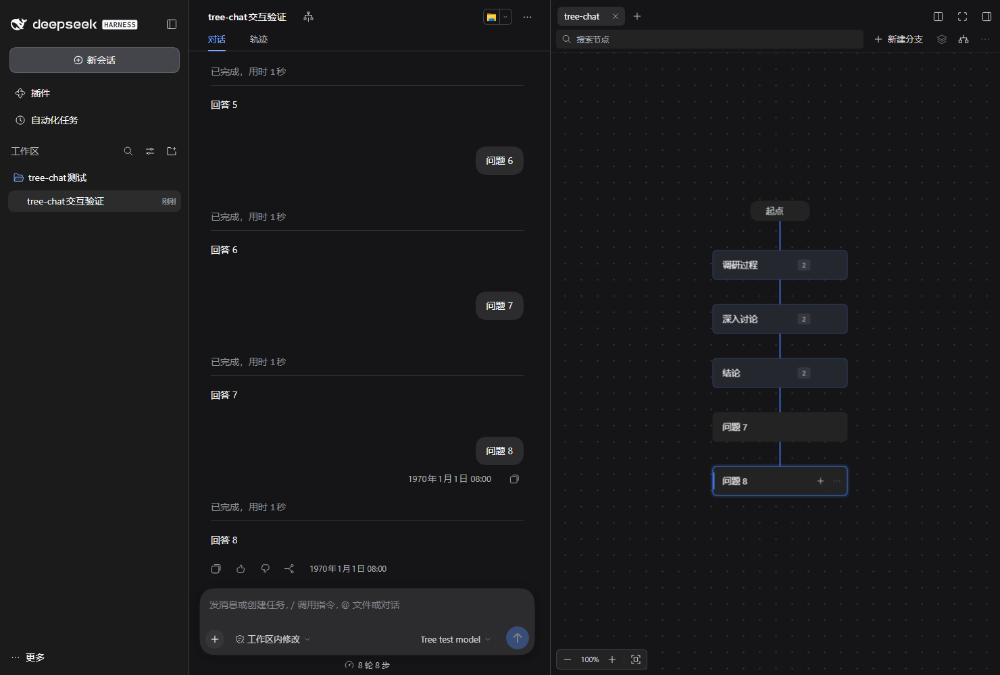

# tree-chat

在 DeepSeek Harness 中用一棵纵向对话树管理深入讨论：从历史节点开新枝，在分支间切换，移除不需要的轮次，让后续回复使用调整后的上下文。

tree-chat 是采用 DSH 标准插件格式的第三方插件，使用原生右侧栏、字体和深浅色主题，无需修改宿主安装文件。



[安装](#安装) · [使用](#使用) · [数据](#数据与上下文) · [常见问题](#常见问题) · [开发](#开发)

## 兼容性

| 项目 | 当前状态 |
| --- | --- |
| 插件版本 | **1.0.0** |
| 已验证宿主 | **DeepSeek Harness 0.2.0-rc.2 / 0.2.1-rc.2** |
| 已验证系统 | Windows |
| 插件格式 | 标准 `dsh.bundle` + `dsh.client` |
| 其他系统及宿主版本 | 尚未完成验证，不保证可用 |

通过 DSH 界面安装不需要手动运行 Node、npm 或构建命令。发行包已包含运行文件；开发源码需要 Node.js 22 或更新版本。

## 安装

### 在 DSH 界面直接安装

1. 打开 DSH 左侧 **插件 → 添加插件**。
2. 在 **包名或地址** 中粘贴完整地址：

   ```text
   https://github.com/DevourerM/tree-chat/releases/download/v1.0.0/tree-chat-1.0.0.tgz
   ```

3. 确认插件为 **tree-chat**，点击 **安装**。
4. 安装完成后点击 **立即启用**；宿主提示重启时，按提示操作。
5. 打开普通聊天，点击页头树形 **tree-chat** 按钮，显示右侧对话树。

固定版本地址不会随仓库提交而改变内容。无需下载源码或额外执行安装脚本。

也可在同一输入框使用固定标签的 Git 地址：

```text
git+https://github.com/DevourerM/tree-chat.git#v1.0.0
```

推荐 `.tgz` 地址，它不要求安装 Git。插件尚未发布到 npm，请不要只填写 `tree-chat`，以免解析到其他来源的同名包。

### 网络受限时离线安装

从 [Releases](https://github.com/DevourerM/tree-chat/releases) 下载 `tree-chat-1.0.0.tgz`，在 DSH 的同一输入框填写其**本机绝对路径**，例如：

```text
C:\Downloads\tree-chat-1.0.0.tgz
```

选择发行附件 `.tgz`，不要选 GitHub 自动生成的 “Source code” ZIP。远程 Web Host 的本地路径指向 Host 电脑，而不是浏览器所在电脑。

### 更新与卸载

更新前查看新 Release 的宿主兼容性说明，再通过 DSH 的更新或重新安装流程填写新版本地址，避免同时启用多个副本。禁用或卸载从 DSH 插件界面操作。

卸载不删除原生聊天与树数据。自动归档的会话仍可从 DSH 的归档列表恢复。

## 功能

- 纵向对话树，默认展示真实用户输入，折叠权限提示、自动续跑等内部轮次，保留完整模型上下文。
- 从任意历史节点创建持久分支节点，使用 DSH 原生聊天输入框，首轮完成后原位填入内容。
- 单击选中、双击定位，拖动节点调整布局；支持缩放、平移、搜索，以及保留手动左右顺序的节点整理。
- 将相连节点合并成命名集合，随时展开、拆分、重新合并；所有原始上下文完整保留。
- 新建或切回分支时继承当前 DSH 权限设置，包括自定义沙箱与审批组合。
- 删除中间轮次后自动接好后续路径，支持撤销、重做。
- 同一棵树在 DSH 左侧默认仅保留当前会话可见，其他枝通过原生归档收纳；用户置顶会话例外。
- 继承 DSH 原生侧栏和主题，切换分支时保留树的视野与布局。
- 隐藏或收起的侧栏暂停轮询，重新打开时立即同步；新版宿主切换工作目录后，分枝继承所选节点当时的目录。

连线只展示关系和当前路径；创建分支、裁剪上下文都通过按钮完成，无需手工拉线。

## 使用

### 基本操作

| 操作 | 效果 |
| --- | --- |
| 单击节点正文 | 仅选中，作为新建分支、重命名或删除的目标 |
| 双击节点正文 | 跳转原生聊天的对应消息，自动加载较早记录 |
| 拖动节点正文 | 移动位置，不跳转、不改变上下文 |
| 拖动空白处 | 平移画布 |
| 滚轮、左下角 `− / ＋` | 缩放 |
| 左下角“适合画布” | 调整视野容纳整棵树 |
| 顶部树形整理图标“整理节点” | 按当前左右顺序规整布局，保留上下文关系，支持撤销 |
| 卡片 `…` 或右键 | 打开节点菜单 |

选中边框表示操作对象；蓝色路径及节点左侧色条表示当前聊天使用的分枝。选中历史节点本身不会把下一条输入插入历史中间。

### 新建节点与分支

1. 选中要继续深入讨论的节点。
2. 点击卡片 **＋**、顶部 **新建分支**，或节点菜单中的同名操作。
3. 树上立即出现实线 **新分支** 节点，原生输入框切换到这条新分支。
4. 在原生输入框发送消息，该轮结束后，在同一节点中填入内容，保留节点 ID 与位置，后续聊天沿此枝生长。

每个正式节点代表完整轮次，包括输入、回复和工具交互；不会在工具调用尚未配对时截取半轮上下文。

未填写的分支不会超时消失，切换、刷新和重启后仍保留，也不会被从其他节点新建的分支覆盖。重复从同一父节点创建会复用已有空分支；双击空分支继续填写。右键或 **…** 菜单可继续、重命名或删除空分支，删除当前空分支会返回创建前的会话。

新节点从父节点的当前实际位置向下寻找最近空位，避开已移动的节点。顶部 **整理节点** 按当前左右位置确定分枝顺序，再统一间距与层级；不会恢复成创建时的顺序，也不会改变上下文。

从 **起点** 创建不继承先前用户轮次，但保留宿主必需的系统及工具配置。其他分枝末端节点的菜单提供 **继续这条分支**，优先复用已有原生会话。

### 节点集合与折叠

1. 单击首个节点，按住 **Shift** 点击末个节点，选择两者间的相连路径；也可按住 **Ctrl / ⌘** 逐个增减选择。
2. 点击顶部叠层图标 **合并为集合**，填写名称。所选节点折叠成带名称与数量的卡片。
3. 点击卡片展开按钮，或双击集合卡片，查看内部节点；成员节点上方的名称小标签可再次折叠整组。
4. 集合菜单支持 **重命名集合**、**拆分集合…** 与 **取消集合**。拆分时选择一个内部节点，它及其在集合内的后代成为新组，其余节点保留原组。重复拆分即可得到多个组；不足两个节点的部分恢复为普通节点。
5. 展开后，成员菜单也可 **在此拆分集合…**。选择两个相连的折叠集合，再次合并即可重新组织。

集合只整理显示，不把多轮聊天压缩成摘要，不删除消息、不改变上下文路径。分叉和所有对外出口保留；从内部指定节点继续对话时先展开集合，新增对话保持在集合之外。移动折叠卡片会同步平移成员，展开后仍保留相对位置。

集合不包含起点，不能跳过中间节点，也不允许重叠或嵌套。空分支产生第一轮消息后才能加入集合。默认视图隐藏的内部轮次会随所属输入一起收纳，切换“显示完整轮次”仍可检查全部记录。

搜索命中集合内部节点时临时展开并定位，清除搜索后恢复原折叠状态。创建、命名、拆分、取消与移动均可撤销；单纯展开折叠不占用撤销历史。刷新及重启后集合名称、成员和折叠状态保留。

### 分支权限

通过 tree-chat 新建分支、继续已有分支、跨会话定位或删除当前空分支返回时，目标会话沿用离开前的当前权限选择。覆盖“工作区内修改”“完全权限”及 DSH 自定义的沙箱/审批组合，不再重置成目标分支原来的默认值。

权限仍由 DSH 原生服务写入、显示与执行。Auto 需要宿主自身启用相应审查集成；无法启用时切换失败并提示，不会偷偷降级或绕过审核。树之外手工打开不相关会话的权限行为仍由 DSH 决定。

### 删除轮次，自动接好上下文

原路径：

```text
起点 → 1 → 2 → 3 → 4
```

选择节点 2，打开 **… → 删除节点… → 保留后续**，得到：

```text
起点 → 1 → 3 → 4
```

后续聊天基于新路径。插件会生成合适的原生上下文会话，不改写原始聊天文件。**删除整枝** 则移除所选节点及其后代在树中的位置。

默认折叠视图中，删除用户节点也会移除归属该输入的内部续跑轮次，避免工具结果或自动续跑单独残留。旧数据里未连接的分支，可使用节点菜单 **接回起点**。

### 更多工具与快捷键

顶部 **…** 菜单包含撤销、重做、整理节点、显示完整轮次和导出树结构；搜索框定位并高亮匹配标题。

| 快捷键 | 效果 |
| --- | --- |
| 画布聚焦后方向键 | 选择父、子或同层节点 |
| `Enter` | 定位选中节点 |
| `Shift + Enter` | 从选中节点创建分支 |
| `Ctrl / ⌘ + Z` | 撤销树编辑 |
| `Ctrl / ⌘ + Shift + Z` | 重做树编辑 |
| `Esc` | 取消拖动或关闭当前菜单、对话框 |

快捷键作用于插件获得焦点时。**完成新一轮聊天后，旧的树编辑撤销历史清空**，避免覆盖后来生长的节点。

## 数据与上下文

- 原始 DSH 消息不被修改或物理删除。分支使用标准原生 Session，保留消息、步骤及完整工具调用配对。
- 删除节点修改树及后续上下文，不是从磁盘销毁原始记录。
- 插件自身不新增外部服务请求；聊天仍使用 DSH 配置的模型与工具。
- 为收纳分枝，同树非当前会话会归档，包括切离后的初始根会话；置顶会话保持可见，切换时恢复对应会话。
- 树元数据保存于 `$DSH_HOME/plugins/conversation-tree/graphs`，Windows 默认 `%USERPROFILE%\.dsh\plugins\conversation-tree\graphs`。历史目录名用于兼容，插件包名仍是 `tree-chat`。
- 写入使用临时文件与原子替换，结构修改以版本号检测并发冲突。旧树无需迁移；新增集合元数据使用可选 `groups` 字段，升级后建议持续使用新版，旧版不理解集合。
- 大于 250 个可见节点时按画布范围渲染卡片和连线；无变化的轮询只回传版本确认；批量导入复用位置索引。节点和完整上下文仍保存在树中。
- **导出 JSON 不是完整消息备份。** 迁移时需要同时保留 DSH 原生会话存储与树元数据。

## 常见问题

**安装或下载超时？** 确认可以访问 GitHub Release 附件，或改用离线 `.tgz`；更换 npm 镜像不一定能解决 GitHub 网络问题。

**单击为什么不跳聊天？** 单击只选中。双击或画布聚焦后按 `Enter` 才定位。

**新分支还没输入，会消失吗？** 不会。空分支持续保留，首轮结束后原位填入内容；只有明确删除它才会移除。

**旧分支从左侧消失？** 它被原生归档收纳，仍在树中，可通过树切回或从归档列表恢复。

**生成时不能改上下文？** 等待同树正在生成的会话结束后操作。移动和排列不改变模型上下文。

**已有 fork 没有合并？** 插件不扫描和合并历史 fork；首次打开的普通会话各自形成树，之后由 tree-chat 创建的新枝统一管理。

**压缩或工具配对提示？** 宿主已压缩替代的历史可能不再有可独立重组的有效消息；未完成工具记录也不能安全重建。插件会拒绝应用，原会话保留。

**DSH 升级后能用吗？** 当前已验证 0.2.0-rc.2 和 0.2.1-rc.2，宿主 API 或界面语义标记变化可能需要适配。先查看 [兼容性记录](docs/COMPATIBILITY.md) 和 Release 说明。

协作设计与实现复核记录见 [1.0 设计记录](docs/V1-REVIEW.md)。

## 开发

```bash
git clone https://github.com/DevourerM/tree-chat.git
cd tree-chat
npm run build
npm test
npm run pack:plugin
```

构建与核心测试只使用 Node.js 内置模块。打包会检查 DSH 元数据、完整资源和运行文件，在 `dist/` 生成 `.tgz` 与校验记录。安装时使用宿主服务及 React 单例。

| 目录 | 用途 |
| --- | --- |
| `src/client` | 侧栏、画布、消息定位适配 |
| `src/core` | 图模型、校验和视图投影 |
| `src/host` | 上下文组装、会话映射和存储 |
| `lib` | 预构建的运行文件，随发行包分发 |
| `test`、`scripts` | 核心测试、原生验证、打包和辅助安装 |
| `docs` | 设计、验证、发布审核记录 |

真实宿主验证需自行准备合法取得的 DSH 开发运行时，设置 `DSH_DEV_RUNTIME` 到其 `node_modules` 后执行 `npm run check:host`。GUI 验证需要 Playwright、Chromium、隔离 Host，详见 [验证记录](docs/VALIDATION.md)。宿主运行时、浏览器、用户会话及测试产物不随仓库分发。

| 环境变量 | 用途 |
| --- | --- |
| `DSH_DEV_RUNTIME` | DSH 开发运行时的 `node_modules` 绝对路径，用于原生重放和宿主服务测试 |
| `TREE_PLAYWRIGHT` | 已安装 Playwright 的 `index.mjs` 入口绝对路径 |
| `TREE_CHROMIUM` | GUI 测试使用的 Chromium 可执行文件；未设置则使用 Playwright 默认浏览器 |
| `TREE_ARTIFACTS` | 测试截图、模型请求记录等产物目录 |
| `TREE_TEST_HOME` | 合成聊天 GUI 测试的独立 DSH 数据目录 |
| `TREE_GUI_TEST_HOME` | 从空白配置验证插件安装的独立 DSH 数据目录 |
| `TREE_PLUGIN_SPEC` | GUI 安装测试的包地址；可填 Release URL，未设置时使用本地发行包 |
| `DSH_APP_DIR` | 开发者辅助安装器验证用的 DSH Desktop 安装目录，也可传 `--app` |

缺少宿主运行时时，核心测试仍可执行，宿主服务集成测试会明确跳过；提供运行时后才会实际执行这些集成测试。普通用户安装插件无需设置这些开发变量。

`scripts/install.mjs` 是开发者本机辅助安装器，可用 `--home` 和 `--app` 指定 DSH 数据及安装目录。添加 `--no-backup` 可直接覆盖更新、不创建额外备份，适用于源码已由 Git 管理的本地开发；默认模式保留覆盖前备份。普通用户使用 DSH 插件界面，无需运行它。

运行代码使用公开 Slot、Sidebar 和 Session 能力。最终消息定位依赖的宿主语义标记集中在 `src/client/navigation.js`；升级宿主时需验证这一适配器。插件释放时清理注册、样式、导航等待和计时任务。

## 反馈与许可

请通过 [GitHub Issues](https://github.com/DevourerM/tree-chat/issues) 提交 DSH 版本、复现步骤及必要截图；公开前去掉私密聊天内容与密钥。

[MIT License](LICENSE)。本项目不隶属于 DeepSeek；DeepSeek Harness 名称用于说明兼容目标。
